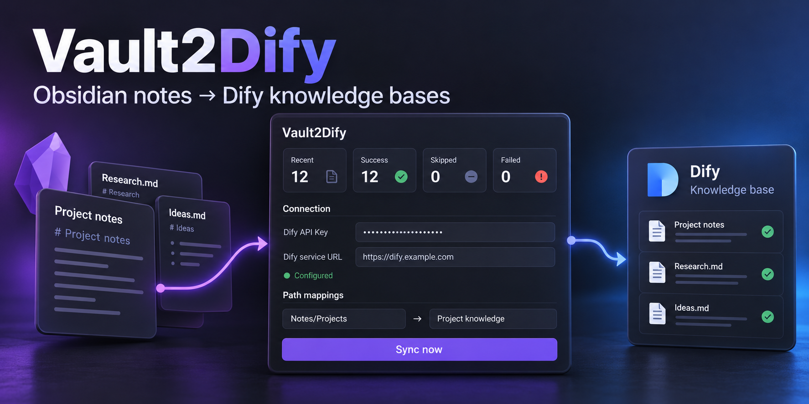
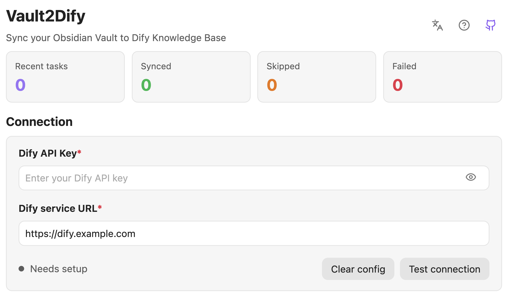
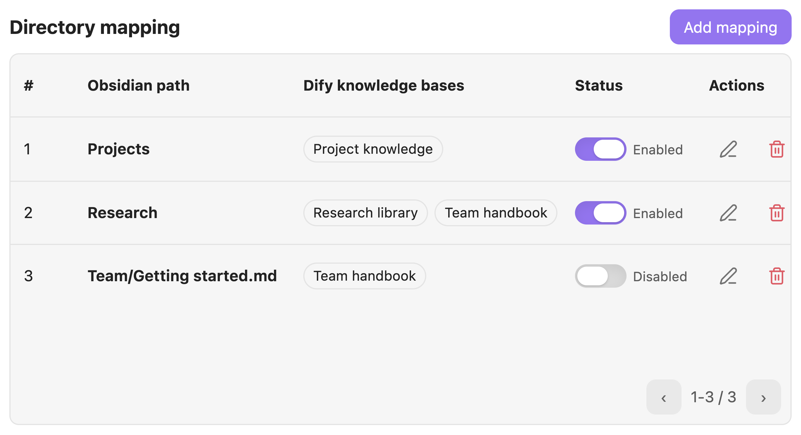
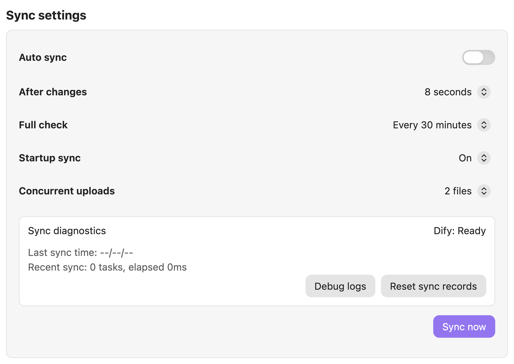

# Vault2Dify

[](https://github.com/BeatsAD/Vault2Dify/releases/latest)
[](https://github.com/BeatsAD/Vault2Dify/actions/workflows/build.yml)
[](LICENSE)

[English](README.md) | 中文

将选定的 Obsidian Markdown 笔记同步到一个或多个 Dify 知识库。

Vault2Dify 是一款桌面端 Obsidian 插件，适合使用 Obsidian 写个人笔记、项目资料或团队知识库，同时使用 Dify 做知识库问答的用户。插件只会把命中已启用路径映射的 Markdown 笔记同步到你配置的 Dify 服务地址。

插件界面默认使用英文。你可以在设置页顶部的语言图标中切换为中文。

## 界面预览

以下为 Obsidian 1.14.4 中的核心英文界面，使用示例配置，未展示真实 Dify 连接。

**连接配置**



**路径映射**



**同步设置**



## 功能

- 将 Obsidian 目录、单篇 Markdown 笔记或整个仓库映射到一个或多个 Dify 知识库。
- 通过 `GET /v1/datasets` 测试 Dify API Key，并自动读取可用知识库。
- 支持从功能区图标、命令面板或设置页手动同步。
- 可选监听 Markdown 创建、修改、重命名事件，并通过定时全量校验兜底。
- 使用一个 Dify 服务地址覆盖本机 Docker、NAS/Docker、局域网、Tailscale、反向代理或 Dify Cloud。
- 按知识库和 Obsidian 文件路径保存同步记录，避免不同目录下同名文件互相覆盖。
- 采用保守删除策略：删除本地笔记或路径映射不会自动删除 Dify 远端文档。
- 支持英文和中文设置、通知、命令与状态信息。

## 文档更新与元数据

Markdown 会作为文本上传，其中包含 YAML frontmatter。**元数据同步**默认关闭，升级后也保持关闭。在**同步设置**中开启后，全部 YAML 属性还会写入 Dify 结构化元数据。同步范围沿用已启用的路径映射，关闭自动同步时仍可手动同步元数据。

已有同名自定义字段会复用，缺少的字段自动创建。文本、数字、ISO 日期分别映射为 Dify 文本、数字和时间字段；布尔值转为 `true`/`false` 文本，列表和对象转为 JSON 文本。已有字段类型保持不变。类型不兼容、YAML 无效或与内置字段重名时，同步诊断会显示具体原因，其余有效属性继续同步。

仅写入本地存在且非空的属性。仅存在于远端的字段、本地已删除或置空的属性，以及关闭开关后的远端数据均会保留。开启或重新开启后，下次同步会补齐元数据，不重复上传未变化的正文。元数据失败时保留文档 ID 和正文成功记录，下次只重试元数据。转换细则见[用户指南](USER_GUIDE_ZH.md#元数据同步)。

更新和重命名会复用已记录的 Dify 文档 ID。更新返回 404 后，只有重新获取的完整文档列表确认原 ID 不存在时，插件才会重建文档。原文档仍存在或无法确认状态时，同步会失败并保留关联信息以便重试。重建的文档使用新 ID，不会继承已删除文档的自定义元数据。

此改进减少意外重建文档的情况，不代表已确认所有元数据丢失报告的原因。请在所用 Dify 版本中，对比更新前与索引完成后的文档 ID 和自定义字段，验证元数据是否保留。

## 快速开始

### 从 Obsidian 安装

1. 在 Obsidian 桌面端打开 `设置 -> 社区插件 -> 浏览`。
2. 搜索 **Vault2Dify**，安装并启用。也可以[打开社区插件页面](https://obsidian.md/plugins?id=vault-to-dify)。
3. 打开 `设置 -> Vault2Dify`，配置连接与路径映射。

### 手动安装

从[最新 Release](https://github.com/BeatsAD/Vault2Dify/releases/latest) 下载 `main.js`、`manifest.json` 和 `styles.css`，将这三个文件放入你的 Obsidian 仓库：

```text
.obsidian/plugins/vault-to-dify/
├── main.js
├── manifest.json
└── styles.css
```

如有需要，重启 Obsidian，在 `设置 -> 社区插件 -> 已安装插件` 中启用 `Vault2Dify`，然后打开 `设置 -> Vault2Dify`。

### 首次配置

1. 填写 Dify 知识库 API Key。
2. 填写运行 Obsidian 的设备可以访问的 Dify 服务地址。
3. 测试连接并读取知识库列表。
4. 新增路径映射。
5. 运行手动同步或启用自动同步。

新安装不会自动上传笔记；需要先配置映射并主动开始同步。

更多说明：

- [安装说明](INSTALLATION_ZH.md)
- [用户指南](USER_GUIDE_ZH.md)
- [连接排错](docs/CONNECTION_TROUBLESHOOTING_ZH.md)

## Dify 服务地址示例

填写运行 Obsidian 的设备可以访问的服务根地址。插件会自动追加 `/v1/datasets` 等 Dify API 路径。

| 部署方式 | 示例 |
| --- | --- |
| 同一台电脑上的本机 Docker | `http://localhost:5000` |
| NAS/Docker 或局域网服务器 | `http://dify-host.example.test:5000` |
| 通过 Tailscale 访问 NAS | `http://tailnet-device.example.test:5000` |
| 反向代理或 Dify Cloud | `https://dify.example.com` |

除非 Dify 和 Obsidian 运行在同一台电脑上，否则不要填写 `localhost`。

## 隐私与网络使用

- 插件会读取当前 Obsidian 仓库中的 Markdown 文件。
- 只有命中已启用路径映射的 Markdown 文件会被发送到你配置的 Dify 服务地址。
- Dify API Key 保存在 Obsidian 插件本地数据中。
- 插件不会把笔记内容发送给插件作者，也不会发送到你配置的 Dify endpoint 以外的服务。
- 删除本地笔记不会自动删除 Dify 远端文档。
- 删除路径映射只会移除本地插件配置。

详见 [SECURITY.md](SECURITY.md)。

## 平台支持

当前版本仅支持桌面端。移动端支持需要单独测试后再启用。

## 开发命令

```bash
npm install
npm test
npm run typecheck
npm run build
```

## 发布文件

发布包只应包含：

```text
main.js
manifest.json
styles.css
```

不要包含 `node_modules`、API Key、本地 Obsidian 仓库数据、插件本地数据、同步记录、原型文件或本地归档。

## 许可证

MIT License
